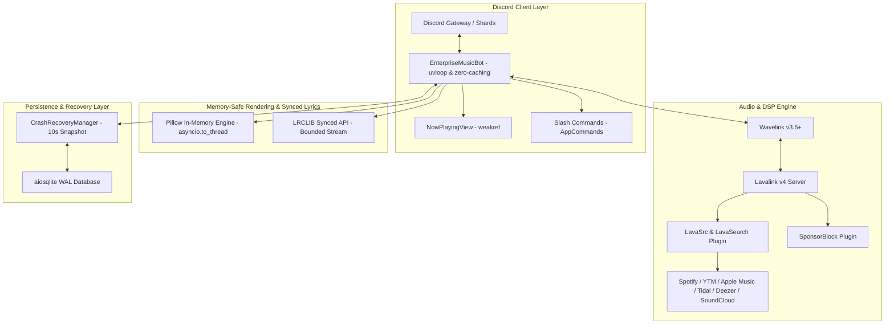

# Enterprise Discord Music Bot (Python 3.12+)

Arsitektur produksi Discord Music Bot enterprise-grade berperforma tinggi yang dibangun menggunakan **Python 3.12+**, didukung oleh runtime **`uvloop`**, framework audio **`wavelink` (v3.5+)** terhubung ke **Lavalink v4**, engine serialisasi **`orjson`**, layer persistensi **`aiosqlite` (WAL Mode)**, rendering kartu visual in-memory **`Pillow`**, serta integrasi API **`LRCLIB`** untuk lirik tersinkronisasi per detik.

---

## 🏛️ Arsitektur Sistem



---

## 🚀 Fitur Utama

1. **Multi-Platform Link & Playlist Engine:**
   - Resolusi instan track, album, dan playlist dari **Spotify, YouTube Music, Apple Music, Tidal, Deezer, dan SoundCloud**.
   - Dilengkapi validasi keamanan SSRF dan whitelist domain musik ketat.

2. **Dynamic In-Memory Now-Playing Visual Card:**
   - Dirender secara in-memory beresolusi tinggi (1000x360 px) menggunakan `Pillow` tanpa menyentuh disk I/O (`io.BytesIO`).
   - Background adaptif (sampling warna dominan cover art), cover art dengan sudut membulat, badge platform berwarna, visual progress bar, serta indikator status audio (EQ, volume, autoplay).
   - Seluruh proses rendering didelegasikan ke threadpool via `asyncio.to_thread`.

3. **Real-Time Throttled Progress & Seek Controls:**
   - Update kartu pemutaran setiap **6 detik** (aman dari rate limit Discord 5 req / 5 detik).
   - Tombol kontrol interaktif: `⏮️ Previous`, `⏯️ Play/Pause`, `⏭️ Skip`, `⏹️ Stop`, `🔀 Shuffle`, `⏪ -15s`, `⏩ +15s`, `🎯 Seek Modal`, `🎛️ Equalizer`, `📜 Lyrics`, `🔁 Loop`, `📻 Autoplay`.
   - `SeekModal` memungkinkan lompatan presisi menggunakan format waktu `MM:SS` atau `HH:MM:SS`.

4. **15-Band Equalizer, DSP Filters & Custom EQ Builder:**
   - **Preset Instan:** *Flat, Bassboost, Pop, Rock, Classical, Electronic, Nightcore (pitch & speed boost), Vaporwave (pitch & speed down), 8D Audio (360° rotation), Vocal Boost (250Hz-2.5kHz)*.
   - **Custom Equalizer Builder:** Pengguna dapat mengatur gain (-0.25 hingga +1.0) pada 5 pita frekuensi utama:
     - `60Hz` (Sub-bass / Punch)
     - `230Hz` (Bass / Warmth)
     - `910Hz` (Midrange Vokal/Instrumen)
     - `4kHz` (Presence / Clarity)
     - `14kHz` (Treble / Airiness)
     - Algoritma interpolasi otomatis memetakan 5 pita ke 15 pita frekuensi Lavalink secara mulus dan menyimpannya ke database SQLite.

5. **Smart Autoplay / Radio Mode:**
   - Memutar rekomendasi lagu serupa secara otomatis melalui engine rekomendasi `LavaSrc` saat antrean kosong.

6. **SponsorBlock Native Integration:**
   - Secara otomatis mendeteksi dan melewati segmen non-musik (sponsor, self-promo, intro, outro, interaksi, keheningan) di YouTube/YouTube Music dengan notifikasi transparan.

7. **Real-Time Synced Lyrics (LRCLIB):**
   - Menampilkan jendela lirik tersinkronisasi (*past lines*, *current line*, dan *upcoming lines*) yang bergulir real-time mengikuti detik lagu berjalan, dengan opsi toggle ke lirik polos (*plain text*).

8. **DJ Role & Dynamic Vote-Skip System:**
   - Validasi hak akses bertingkat: Administrator, pemegang Role DJ, atau pendengar tunggal dapat langsung melewati lagu tanpa vote.
   - Jika terdapat banyak pendengar dalam voice channel, sistem mengaktifkan kuorum vote-skip dinamis (50% + 1).

9. **Persistent State & Crash Recovery (WAL Mode):**
   - Background worker mencatat snapshot milidetik lagu, antrean lengkap, volume, dan filter aktif setiap 10 detik ke SQLite dengan mode `PRAGMA journal_mode=WAL`.
   - Jika bot mati mendadak atau server restart, bot akan otomatis menyambung kembali ke Voice Channel dan melanjutkan pemutaran tepat di detik terakhir terputus.

---

## 🔒 Jaminan Keamanan & Memory-Safety

| Aturan | Implementasi |
| :--- | :--- |
| **Strict Slotted Dataclasses** | Seluruh model data internal (`CustomEQPreset`, `SavedPlayerSession`, `LrcLine`, dll.) menggunakan `@dataclass(slots=True)` untuk efisiensi memori maksimal dan eliminasi overhead dictionary. |
| **Weak References** | Objek `discord.ui.View` (`NowPlayingView`, `SyncedLyricsView`, `EQSelectView`) terhubung ke `MusicPlayer` melalui `weakref.ref(player)` guna mencegah kebocoran memori dari siklus referensi (*circular reference leak*). |
| **Bounded Streams & OOM Prevention** | Unduhan cover art dan payload lirik dibatasi maksimal **5 MB** menggunakan pembacaan berkala (`resp.content.iter_chunked`) dengan pembatalan instan bila ukuran melampaui batas. |
| **Context Managers** | Seluruh objek `Pillow.Image` dan `io.BytesIO` ditutup dalam blok `with` / `finally`. |
| **Anti-SSRF & DNS Rebinding** | URL eksternal wajib berskema `https://` dan divalidasi terhadap whitelist domain musik serta resolusi IP publik (menolak IP privat, localhost, loopback, link-local, dan broadcast). |
| **Input Sanitization** | Gain EQ dibatasi secara ketat pada rentang `[-0.25, 1.0]`, dan input seek divalidasi ke durasi maksimal lagu. |
| **Zero Discord Cache** | Bot menggunakan `MemberCacheFlags.none()` dan `max_messages=None` untuk mempertahankan jejak memori minimal pada ribuan server. |

---

## 📋 Daftar Perintah Slash

| Command | Argumen | Deskripsi |
| :--- | :--- | :--- |
| `/play` | `query` | Memutar lagu atau playlist (URL atau teks pencarian) |
| `/pause` | - | Menjeda pemutaran audio |
| `/resume` | - | Melanjutkan pemutaran audio |
| `/skip` | - | Melewati lagu (Bypass DJ/Admin/Solo atau Vote-Skip) |
| `/seek` | `timestamp` | Menggeser posisi lagu (format `MM:SS` atau `HH:MM:SS`) |
| `/stop` | - | Menghentikan audio, mengosongkan antrean, dan keluar VC |
| `/queue` | - | Melihat daftar antrean lagu aktif |
| `/nowplaying` | - | Memperbarui/menampilkan kartu visual Now-Playing |
| `/autoplay` | - | Mengaktifkan/menonaktifkan mode Smart Autoplay |
| `/volume` | `level` | Mengatur volume pemutar (0 - 150%) |
| `/shuffle` | - | Mengacak urutan antrean lagu |
| `/filter preset` | `preset` | Memilih preset EQ/DSP instan |
| `/filter custom` | `60hz`, `230hz`, `910hz`, `4k`, `14k`, `[save_as]` | Meracik 5 pita frekuensi & menyimpan preset |
| `/filter load` | `name` | Memuat preset custom milik pengguna dari database |
| `/filter list` | - | Menampilkan daftar preset custom milik pengguna |
| `/filter delete` | `name` | Menghapus preset custom yang tersimpan |
| `/filter reset` | - | Mereset filter dan EQ ke kondisi Flat (orisinil) |
| `/lyrics` | `[query]` | Menampilkan lirik lagu tersinkronisasi real-time |

---

## ⚙️ Persiapan & Instalasi

### 1. Prasyarat Sistem
- Python 3.12+ (disertai `uvloop` untuk Linux/Unix).
- Java 17+ (untuk menjalankan Lavalink v4).

### 2. Konfigurasi Lavalink v4
Salin berkas `application.yml.example` menjadi `application.yml` di direktori Lavalink Anda, lengkapi kredensial Spotify/Apple Music, lalu jalankan:
```bash
java -jar Lavalink.jar
```

### 3. Konfigurasi Bot
Salin contoh environment variable:
```bash
cp .env.example .env
```
Sesuaikan isi `.env`:
```env
DISCORD_TOKEN=your_bot_token_here
DISCORD_CLIENT_ID=your_client_id_here
LAVALINK_URI=http://127.0.0.1:2333
LAVALINK_PASSWORD=youshallnotpass
LAVALINK_IDENTIFIER=primary-node
DATABASE_PATH=bot_music.db
DJ_ROLE_NAME=DJ
```

### 4. Menjalankan Unit Tests
```bash
source .venv/bin/activate
pytest -v
```

### 5. Menjalankan Bot
```bash
source .venv/bin/activate
python main.py
```
